<p align="center">
  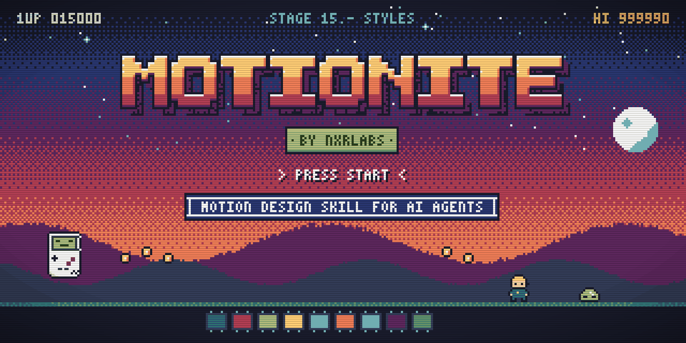
</p>

<h3 align="center">Motionite <sub>by NxrLabs</sub></h3>
<p align="center">A motion-design skill that lets any AI agent make high-quality <a href="https://www.remotion.dev">Remotion</a> videos.<br>
15 house styles · 70 ID'd techniques · universal motion laws · a QA loop that proves the result.</p>

---

## What is Motionite?

Most AI-made motion graphics look the same: fade-in text, centred cards and random easing. Motionite is a single, self-contained **agent skill** that fixes that. It packs a motion designer's working knowledge into files an agent can follow:

- **[`SKILL.md`](SKILL.md):** the workflow (brief → mood board → shot list → pick an NxrStyle → Remotion build → stills approval → render → QA → self-critique) and the taste rules.
- **[`styles/`](styles/):** 15 complete visual systems, **NxrStyle 01–15**. Each style file gives the visual DNA (palette, type, layout, motion, transitions, timing, audio), technique IDs, do/don't, an example brief with a frame-exact shot list, and a Remotion starter. Start with [COMPARISON.md](styles/COMPARISON.md) to choose one.
- **[`techniques/`](techniques/README.md):** 70 techniques with IDs (T type · N numbers · X transitions · C camera · U UI · H hand-drawn · R documented). Every one has its build and its exact numbers. There are also the [laws](techniques/laws.md), the [QA commands](techniques/qa.md) and a [prompt skeleton](techniques/prompt-skeleton.md).
- **[`examples/`](examples/):** a working Remotion 4 project with 48 technique demo comps and one comp per NxrStyle. Every image in this README was rendered from it.

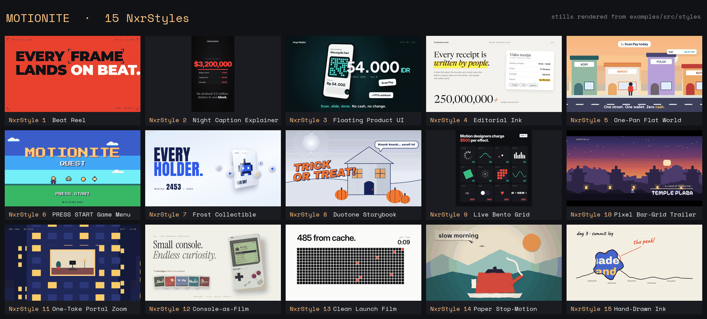

## Quick start

**Option A: give your agent the whole skill**
```bash
git clone <this-repo> motionite
cp -r motionite <your-agent-skills-folder>/motionite
```

**Option B: just the brain.** Copy [`SKILL.md`](SKILL.md) into your agent's context or system prompt. It links to the style and technique files, and works best with them alongside.

**Run the examples**
```bash
cd examples
npm ci
npm run studio                       # browse every NxrStyle + technique comp
npx remotion still src/index.ts NxrStyle13-LaunchFilm out.png --frame=100
npx remotion render src/index.ts TechniqueReel out/technique-reel.mp4   # 48 techniques, 2 min
```

Then ask your agent something like: *"Use Motionite. Make a 6-second 16:9 launch film for our CLI tool, NxrStyle 13, at 120 BPM. Show me stills first."*

## Style index

| # | Style | Vibe | Best for | Thumbnail |
|---|---|---|---|---|
| 01 | [**Beat Reel**](styles/NxrStyle-01-beat-reel.md) | Flat colour fields swap on the bar; slamming type; HUD chrome | Brand sizzle, music-led promo | 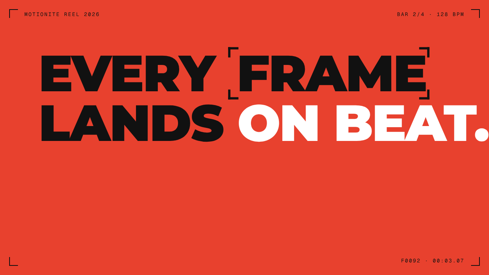 |
| 02 | [**Night Caption Explainer**](styles/NxrStyle-02-night-caption-explainer.md) | 9:16 near-black captions, one giant number, flip to paper + stamp | Shorts/Reels explainers, stats | 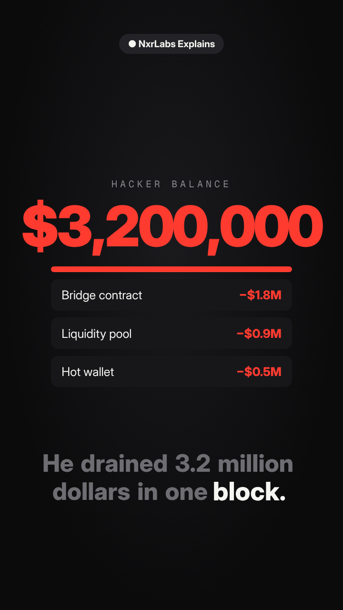 |
| 03 | [**Floating Product UI**](styles/NxrStyle-03-floating-product-ui.md) | Real UI in a tilted 3D phone; giant number overlaps it; chips float | App / fintech launch | 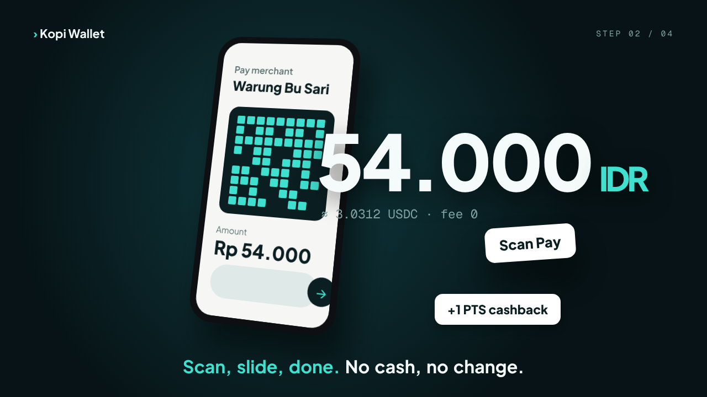 |
| 04 | [**Editorial Ink**](styles/NxrStyle-04-editorial-ink.md) | Off-white page, serif inks in word by word, yellow highlighter | Manifestos, B2B narrative | 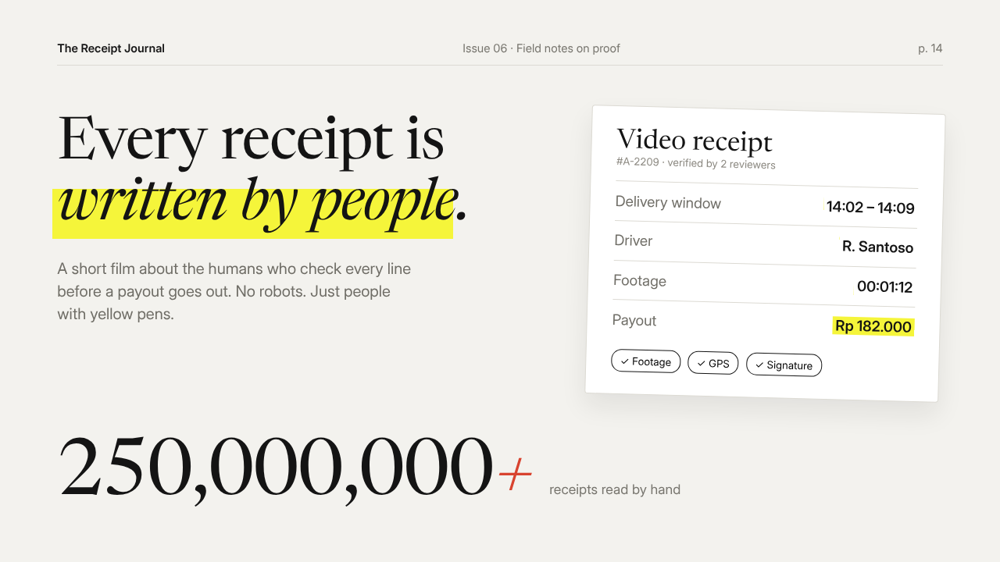 |
| 05 | [**One-Pan Flat World**](styles/NxrStyle-05-one-pan-flat-world.md) | One camera truck through a flat street; sky follows x | Customer journey, "a day with…" | 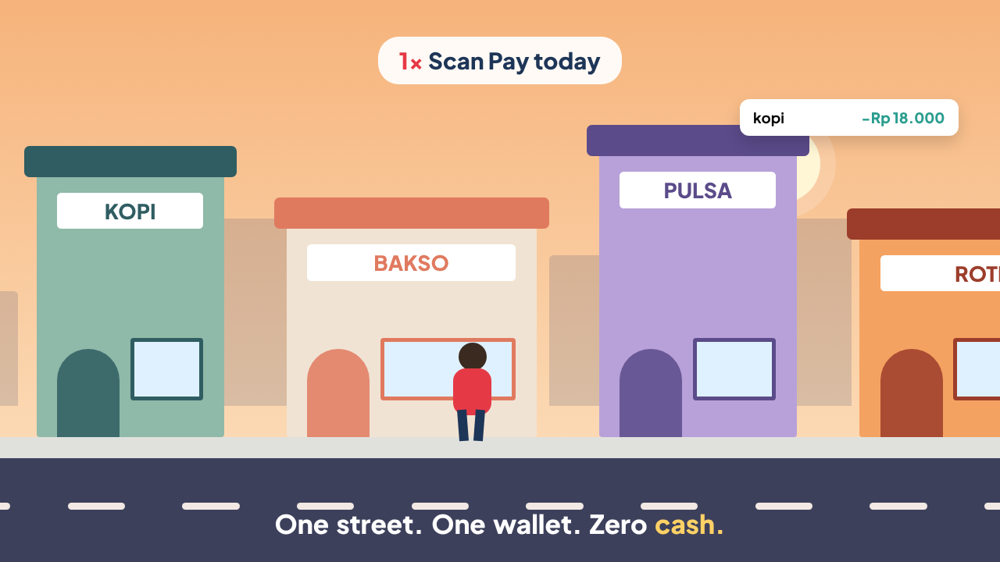 |
| 06 | [**PRESS START Game Menu**](styles/NxrStyle-06-press-start-menu.md) | Retro game menu: 8-bit bands, chunky pixel type, PRESS START blink | Retro, gaming, playful launch | 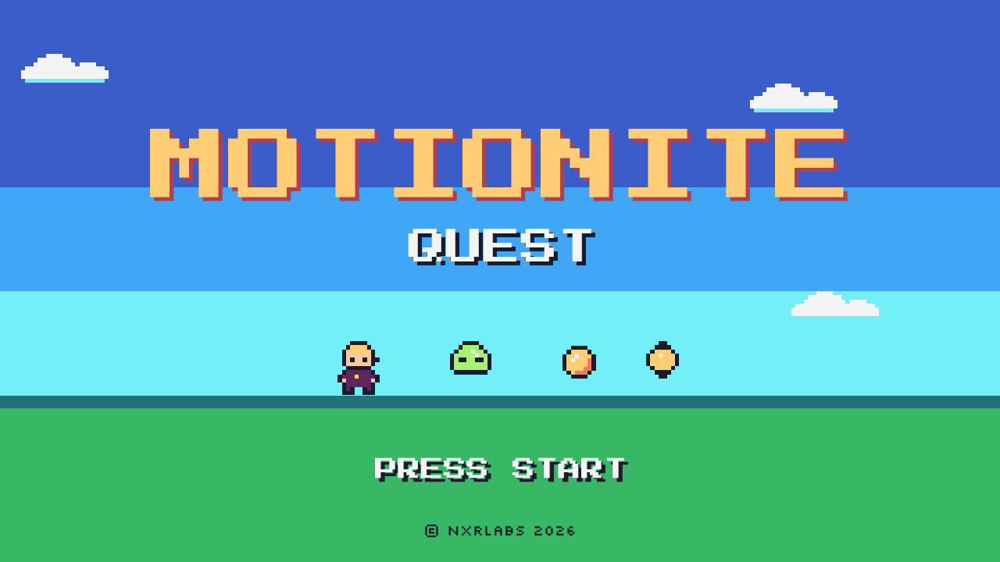 |
| 07 | [**Frost Collectible**](styles/NxrStyle-07-frost-collectible.md) | Icy sky, blur-swap caps, orbiting icons, mint counter, card flip | Mints, drops, collectibles | 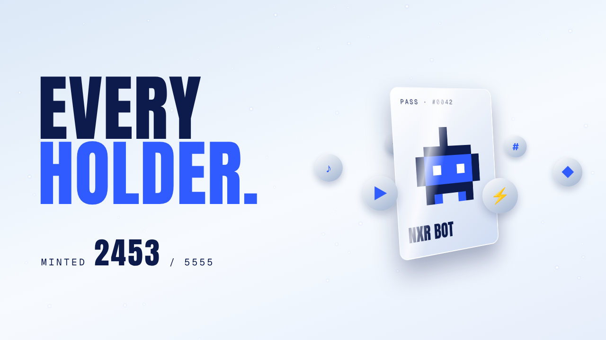 |
| 08 | [**Duotone Storybook**](styles/NxrStyle-08-duotone-storybook.md) | Engraved navy hatching on paper + one warm accent, comic slam | Stories, seasonal, fables | 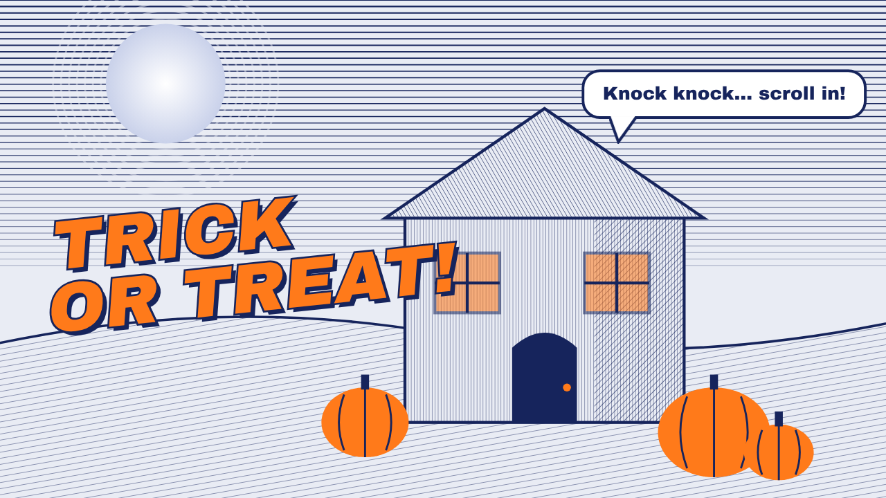 |
| 09 | [**Live Bento Grid**](styles/NxrStyle-09-live-bento-grid.md) | 1:1 poster of live tiles; chips flip on beat; loops | 1:1 feed post, pricing argument | 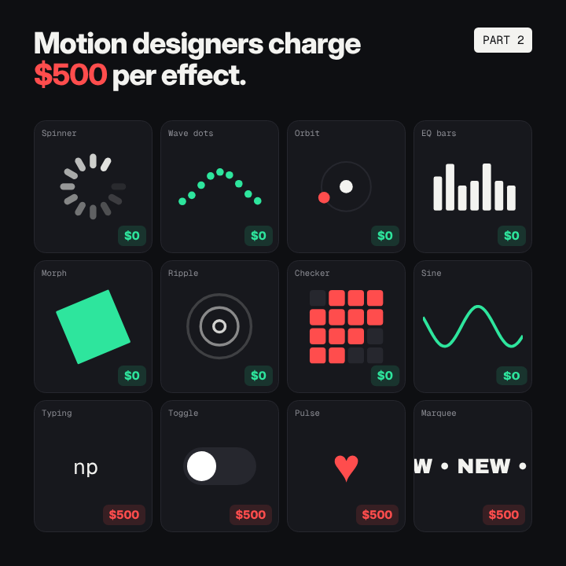 |
| 10 | [**Pixel Bar-Grid Trailer**](styles/NxrStyle-10-pixel-bar-grid-trailer.md) | Pixel world first; parallax plates; cuts on bars; dither wipes | Game trailers | 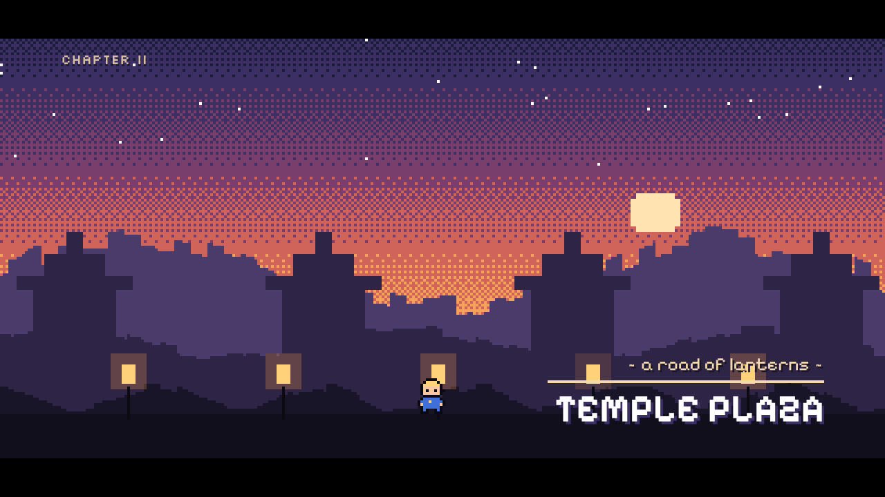 |
| 11 | [**One-Take Portal Zoom**](styles/NxrStyle-11-one-take-portal-zoom.md) | One unbroken log zoom; each world sits in the last one's portal | Big-picture → detail, loops | 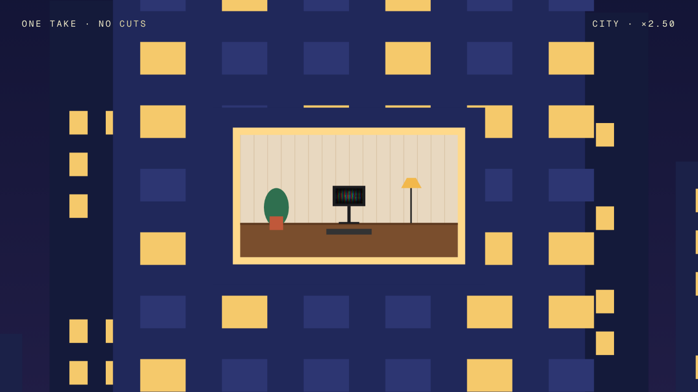 |
| 12 | [**Console-as-Film**](styles/NxrStyle-12-console-as-film.md) | The product object is the set: paper, serif + italic, dolly in | Hardware, physical product | 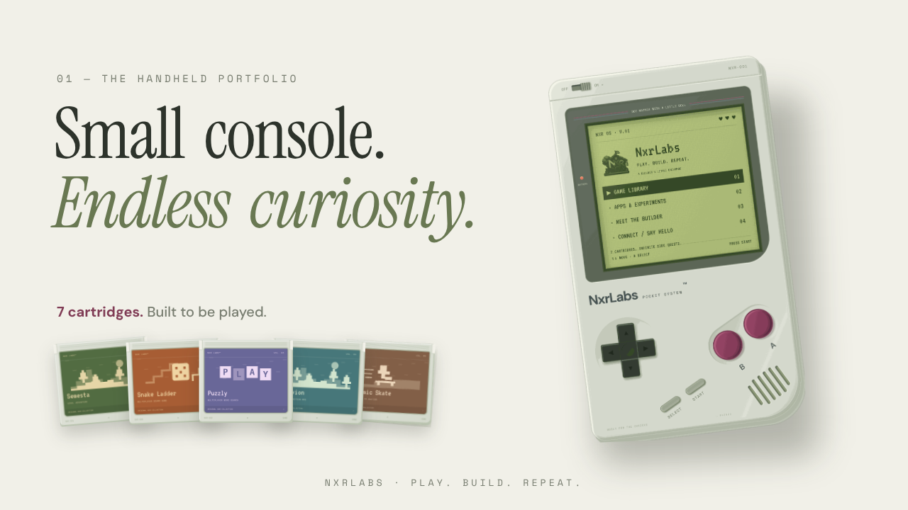 |
| 13 | [**Clean Launch Film**](styles/NxrStyle-13-clean-launch-film.md) | Near-white, one sans, one meaningful accent, scale-through cuts | Dev tools, infra, serious SaaS | 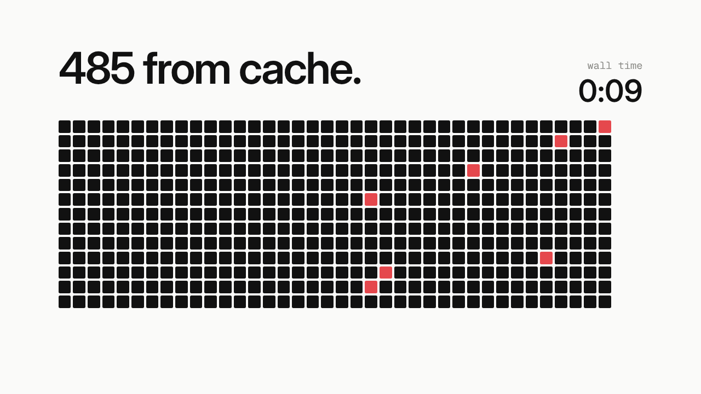 |
| 14 | [**Paper Stop-Motion**](styles/NxrStyle-14-paper-stop-motion.md) | Cut-paper puppets on 12s, camera on ones, riso, verlet steam | Cosy brand story, music piece | 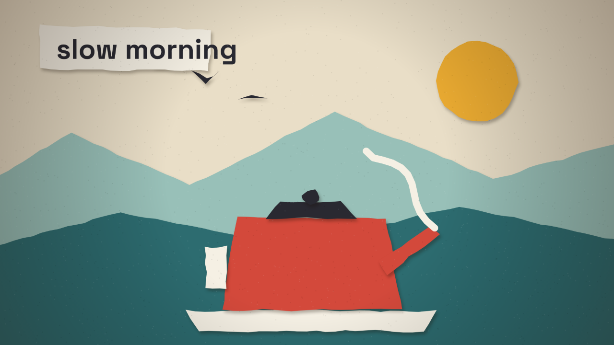 |
| 15 | [**Hand-Drawn Ink**](styles/NxrStyle-15-hand-drawn-ink.md) | Lines self-draw and boil on twos; ink blot into riso halftone | Tutorials, journals, "made by hand" | 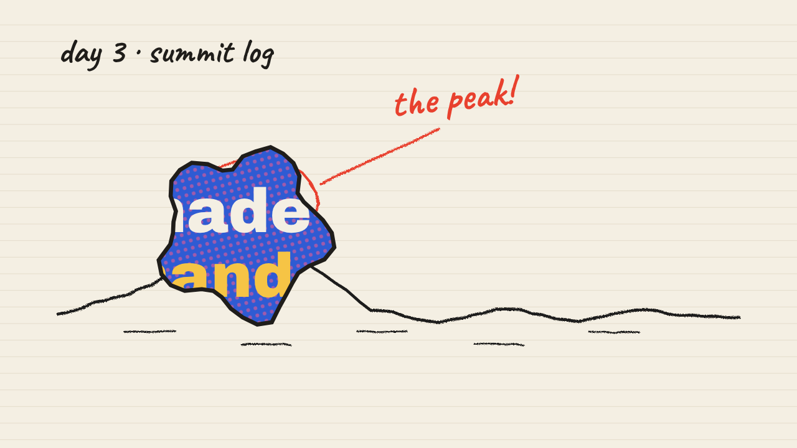 |
The full comparison and a "which style for which brief" table are in [styles/COMPARISON.md](styles/COMPARISON.md).

## Techniques at a glance

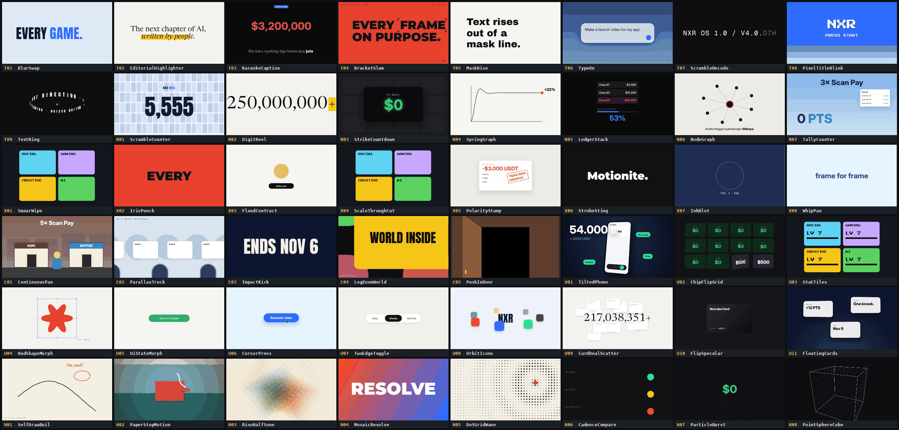

| Family | IDs | Examples |
|---|---|---|
| Type | [T01–T09](techniques/type.md) | anchor + blur swap, karaoke captions, bracket slam, scramble decode, 3D text ring |
| Numbers | [N01–N07](techniques/numbers.md) | scramble counter with ghosting, digit reel with detent, strike + count-down to $0 |
| Transitions | [X01–X08](techniques/transitions.md) | vertical smear, iris punch-through, flood/contract, scale-through cut, ink blot |
| Camera | [C01–C05](techniques/camera.md) | continuous pan + time of day, parallax truck, impact kick, log-zoom world |
| UI | [U01–U11](techniques/ui.md) | tilted 3D phone, chip flip on beat, UI-state morph, two-edge spring toggle |
| Hand-drawn | [H01–H08](techniques/drawn.md) | self-draw + boil on twos, paper stop-motion, riso halftone, mosaic resolve |
| Documented | [R01–R22](techniques/documented.md) | goo/metaball, liquid glass, 6-blade iris, subframe motion blur, sand animation |

## Principles (the short version)

1. **Time is the only input.** `render(frame)` is pure and seeded, so the same frame always gives the same pixels.
2. **Entrances decay, exits accelerate. Scale in log space. Retargets are sums of springs.**
3. **Frame 0 is the poster.** Text blurs in rather than fading.
4. **One accent, one idea per beat, cuts on the bar.**
5. **Budgets:** ≤ 2 overshoots (none on type), ≤ 2 flashes (capped at 65–85 %), and no two transition devices in a row.
6. **Prove it:** ffprobe, −14 LUFS, a contact sheet from the final MP4, a determinism diff, and three critique rounds.

## Repo layout

```
motionite/
├── SKILL.md            ← the skill (start here)
├── styles/             ← NxrStyle-01…15 + COMPARISON.md
├── techniques/         ← laws, T/N/X/C/U/H/R techniques, QA, prompt skeleton
├── examples/           ← Remotion project: src/lib, src/tech, src/styles, stills/
├── assets/             ← banner, styles grid, techniques sheet
├── scripts/            ← banner/grid/sheet generators, render-stills, check-links
└── LICENSE
```

## License

- **Code** (`examples/`, `scripts/`, the snippets in the docs) is licensed **[MIT](LICENSE)**, © 2026 NxrLabs.
- **Written docs** are also MIT.
- **[Remotion](https://www.remotion.dev/license)** has its own license. Companies above a certain size need a company license to use it.
- Fonts in `examples/public/fonts` are under the SIL Open Font License 1.1; see [`examples/public/fonts/licenses/`](examples/public/fonts/licenses/).

Security: see [SECURITY.md](SECURITY.md) for how to report a problem.

<p align="center"><sub>Made by NxrLabs</sub></p>
